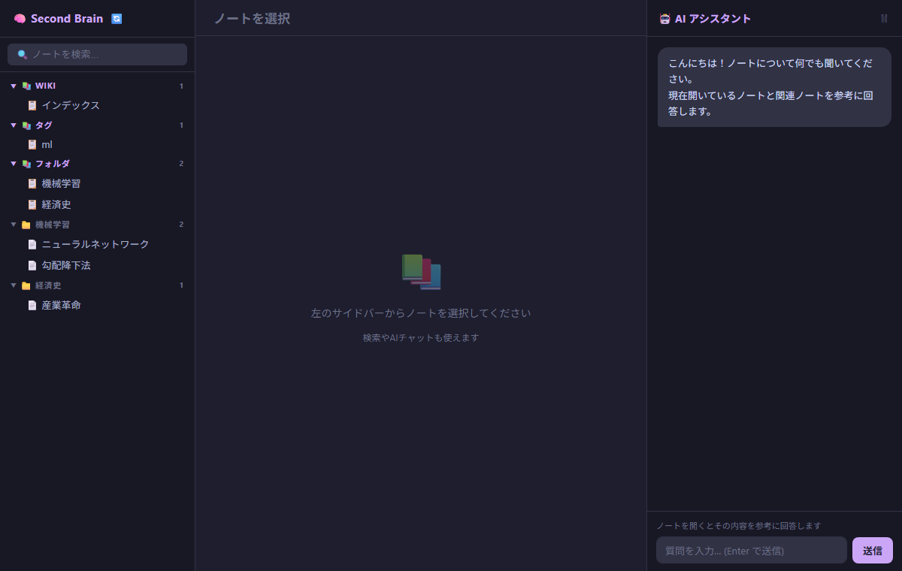

<div align="center">

# 🧠 Second Brain

**Obsidian の Vault を検索し、ノートを根拠に Gemini と対話するローカル Web アプリ。**

[](https://www.python.org/)
[](https://fastapi.tiangolo.com/)
[](https://ai.google.dev/)
[](LICENSE)

</div>

<p align="center"></p>

## ✨ Features

- 🔎 **日本語対応の全文検索** — CJK はバイグラム、英数字は単語で分割した BM25 検索
- 💬 **ノート対話** — 開いているノートと関連ノートを文脈に Gemini が回答し、参照元を明示
- 🔗 **バックリンク表示** — `[[wikilink]]` から被リンクを自動抽出
- 📚 **Wiki 自動生成** — Vault 内に `wiki/` ページを生成(ファイル変更を監視して再構築)
- 🌐 **ブラウザ単体で動作** — HTML を開くだけ(File System Access API)
- 🧹 **Vault 正規化ツール** — frontmatter と関連リンクを一括付与(`normalize_vault.py`、既定はドライラン)

## 🚀 Quick Start

```bash
git clone https://github.com/aauua16/Second-brain.git
cd Second-brain
pip install -r requirements.txt
cp .env.example .env      # VAULT_PATH と GEMINI_API_KEY を記入
python -m uvicorn main:app --port 8000
```

Windows なら `start.bat` をダブルクリック。<http://localhost:8000> を開きます。

## 📂 サーバーなしで使う(HTMLを直接開く)

Python もサーバーも不要です。`static/index.html` を **Chrome / Edge** で開き(`local-backend.js` と同じフォルダに置く)、

1. **📂 Vault フォルダを選択**で Obsidian の Vault を選ぶ(初回のみ。次回以降は「再接続」ボタン)
2. AI 質問を使うなら **⚙️** で [Gemini API キー](https://aistudio.google.com/apikey)を入力(このブラウザの localStorage にのみ保存)

検索(BM25)・閲覧・バックリンク・Wiki 生成(🔄)・AI 質問がすべてブラウザ内で動きます。`.env` は不要です。

> サーバー版との違い: ファイル変更の自動監視と、新規ノートへの「関連ノート」自動追記はありません。Wiki は 🔄 を押したときに `wiki/` へ書き出されます。

## ⚙️ Configuration (`.env`) — サーバー版

`.env.example` を `.env` にコピーして編集します(`.env` は Git 管理外)。

```env
VAULT_PATH=C:\Users\you\Documents\MyVault
GEMINI_API_KEY=取得したAPIキー
```

- **`VAULT_PATH`** — Obsidian で開いている Vault のフォルダ(`.obsidian` フォルダがある場所)の絶対パス。中の `.md` を再帰的に読み込み、`wiki/` もここに生成されます。引用符は不要です。
- **`GEMINI_API_KEY`** — [Google AI Studio](https://aistudio.google.com/apikey) で発行したキーを `=` の右にそのまま貼り付けます。

| 変数 | 説明 |
| --- | --- |
| `VAULT_PATH` | Obsidian Vault のルートフォルダ |
| `GEMINI_API_KEY` | [Google AI Studio](https://aistudio.google.com/apikey) で取得した API キー |

## 🗂️ Structure

```
second-brain/
├── main.py             # FastAPI アプリ(API・ファイル監視・チャット)
├── search.py           # BM25 検索(日本語トークナイザ)
├── static/local-backend.js  # ブラウザ単体版のバックエンド(検索・Wiki・Gemini)
├── wiki_gen.py         # wiki ページ生成
├── normalize_vault.py  # Vault 正規化 CLI
└── static/index.html   # フロントエンド(サーバー版 / 単体版 兼用)
```

## 🔐 Security notes

- 単体版では、AI 質問時に該当ノートの一部がブラウザから直接 Gemini API に送られます。API キーは各自のブラウザにのみ保存され、ファイルやリポジトリには含まれません。
- 認証はありません。既定では `127.0.0.1` のみで待ち受けます(`start.bat`)。LAN 公開する場合は `HOST=0.0.0.0` を設定し、信頼できるネットワークでのみ使ってください。
- ノート本文は質問のたびに Gemini API へ送信されます。機密ノートを含む Vault では注意してください。
- `.env`(API キー)は Git 管理外です。

## 📄 License

[MIT](LICENSE)
